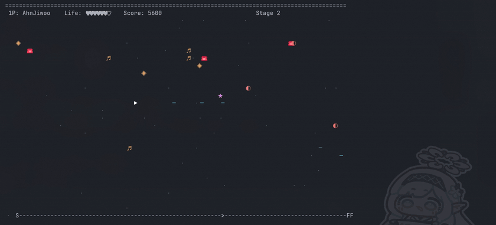
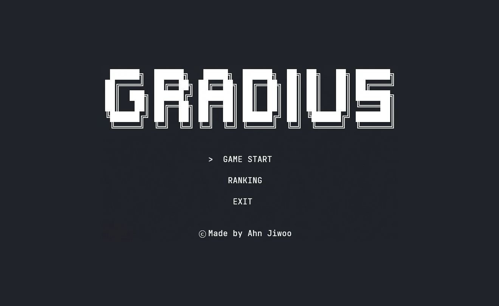
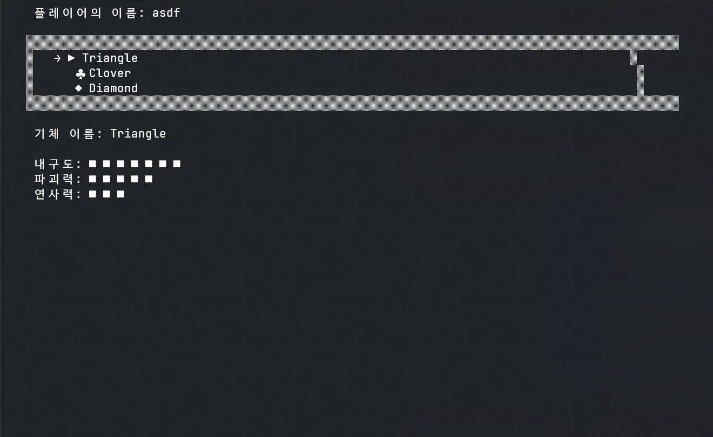
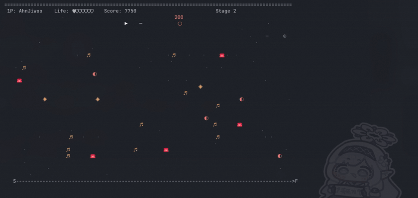
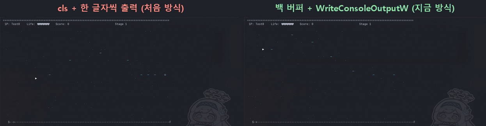
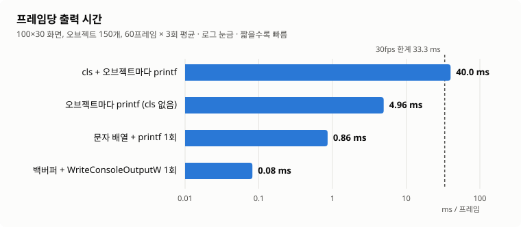

<div align="center">

# TextGradius

**콘솔 텍스트 출력으로 동작하는 횡스크롤 슈팅 게임**


<p align="center"></p>

</div>

## Contents

- [프로젝트 소개](#프로젝트-소개)
- [콘솔 렌더링](#콘솔-렌더링)
- [씬 전환과 게임 루프](#씬-전환과-게임-루프)
- [오브젝트 풀](#오브젝트-풀)
- [빌드 및 실행](#빌드-및-실행)

<br>

## 프로젝트 소개

고전 슈팅 게임 그라디우스의 횡스크롤 전투를 Windows 콘솔 위에 구현한 프로젝트입니다. 그래픽 라이브러리 없이 100×30 칸의 콘솔 화면에 문자를 출력해 게임을 그립니다. 기체는 `▶`, `♣`, `◆`, 적은 `◐`, `☎`, `★`, 탄환은 `─`, `◈`, `♬` 같은 문자로 표현하고, 색은 콘솔의 글자·배경 색상 속성으로 구분합니다. 화면은 30fps로 갱신됩니다.

게임은 타이틀에서 이름을 입력하고 기체를 고르는 것으로 시작합니다. 스테이지마다 5초의 소개 화면이 지나면 전투가 시작되고, 940틱 동안 살아남으면 다음 스테이지로 넘어갑니다. 두 스테이지를 모두 버티거나 체력을 모두 잃으면 결과 화면이 나오고, 이름과 점수가 랭킹에 기록됩니다.

<p align="center"></p>
<p align="center"><sub>타이틀 로고와 메뉴도 게임 화면과 같은 방식으로 콘솔 문자 버퍼에 그립니다.</sub></p>

문자 하나가 한 칸을 차지하는 화면에서는 움직임과 충돌도 칸 단위로 처리됩니다. 아래에서는 이 화면을 매 프레임 끊김 없이 출력하는 방법을 중심으로, 화면 전환과 오브젝트 관리 구조를 설명합니다.

### 기체와 적

기체는 Triangle, Clover, Diamond 세 가지입니다. 기체 선택 화면은 내구도, 파괴력, 연사력을 막대로 보여 줍니다. 모든 적의 체력이 14로 같기 때문에, 기체의 차이는 몇 발로 적을 격추하느냐와 얼마나 자주 쏘느냐로 드러납니다.

<p align="center"></p>
<p align="center"><sub>사격은 자동으로 이루어지며, 플레이어는 방향키로 이동만 조작합니다.</sub></p>

| 기체 | 내구도 | 파괴력 | 발사 간격 | 격추에 필요한 탄 |
|---|---:|---:|---:|---:|
| ▶ Triangle | 7 | 5 | 4틱 | 3발 |
| ♣ Clover | 5 | 3 | 2틱 | 5발 |
| ◆ Diamond | 6 | 7 | 6틱 | 2발 |

적은 오른쪽 끝에서 나타나 왼쪽으로 이동합니다. Uros(`◐`)는 위아래로 흔들리며 다가와 30틱마다 직선탄을 쏩니다. Call(`☎`)은 곧게 날아오며 45틱마다 세 방향으로 탄을 퍼뜨립니다. 두 번째 스테이지의 300틱 이후에 등장하는 Starman(`★`)은 탄을 쏘지 않는 대신, 플레이어 쪽으로 속도를 조금씩 바꾸며 부딪혀 옵니다. Starman은 등장 후 40틱이 지나면 스스로 사라지므로, 그 전에 격추해야 200점을 얻습니다. 부딪히면 피해를 입고 10점만 남습니다.

플레이어가 적이나 적 탄환에 닿으면 체력이 1 줄고, 30틱 동안 무적 상태가 되며 기체 위에 `피격!`이 표시됩니다. 격추된 적은 6틱 동안 그 자리에 점수와 폭발 문자를 남긴 뒤 사라지고, 이때 점수가 합산됩니다.

### 랭킹

결과 화면에서 Enter를 누르면 플레이 ID, 이름, 점수가 `gamedata.sav`에 한 줄씩 추가됩니다. 랭킹 화면은 이 파일을 읽어 점수순으로 정렬해 상위 10개를 보여 줍니다. 저장 형식은 공백으로 구분한 텍스트이므로, 이름 입력에서는 공백을 받지 않고 길이를 10자로 제한했습니다.

<p align="center"></p>

<br>

## 콘솔 렌더링

콘솔 게임은 매 프레임 화면 전체를 다시 출력해야 합니다. 그래픽 API처럼 화면을 그리는 별도의 장치가 없으므로, 출력 방식이 곧 프레임 레이트와 화면 품질을 결정합니다. 이 프로젝트에서 가장 많이 바뀐 부분도 출력 방식입니다.

### 처음 방식의 문제

처음에는 매 프레임 `system("cls")`로 화면을 지운 뒤, 오브젝트마다 커서를 옮기고 `printf`로 문자를 썼습니다. 이 방식에서는 화면이 지워진 순간과 오브젝트가 하나씩 다시 채워지는 과정이 그대로 보여 화면이 심하게 깜빡였습니다. 프레임도 크게 떨어져, 실제 플레이에서는 게임을 진행하기 어려울 정도였습니다.

<p align="center"></p>
<p align="center"><sub>왼쪽은 처음 방식, 오른쪽은 현재 방식입니다. 같은 게임을 출력 방식만 바꿔 실행했습니다.</sub></p>

당시에는 원인을 찾지 못했습니다. 이후 출력 과정을 다시 살펴보면서, 문제는 화면을 그리는 계산이 아니라 문자를 콘솔로 보내는 경로와 그 횟수에 있다는 것을 알게 됐습니다.

### printf가 거치는 과정

`printf`는 콘솔에 바로 쓰는 함수가 아닙니다. 먼저 포맷 문자열을 파싱하고, 인자를 문자열로 변환합니다. 그다음 CRT의 stdout 스트림에서 잠금을 걸고, 버퍼를 관리하고, 스트림 상태를 확인하고, 로케일에 맞춰 인코딩을 처리합니다. 이 과정을 모두 거친 뒤에야 Windows 출력 API가 호출되고, 콘솔 호스트가 화면에 문자를 표시합니다.

처음 방식은 문자 하나를 쓸 때마다 커서 이동과 함께 이 경로를 한 번씩 지나갑니다. 화면에 오브젝트가 많아질수록 같은 비용이 그만큼 반복됩니다. 여기에 `system("cls")`는 호출할 때마다 명령 해석기 프로세스를 실행해 화면을 지우므로, 프레임마다 프로세스 생성 비용까지 더해집니다.

### 백버퍼와 한 번의 출력

그래서 포맷 처리가 필요 없는 콘솔 API `WriteConsoleOutputW`를 직접 사용했습니다. 이 함수는 문자와 색상 속성을 담은 `CHAR_INFO` 배열을 받아 지정한 사각형 영역에 한 번에 씁니다.

다만 콘솔 API도 호출할 때마다 시스템 호출을 거쳐 콘솔 호스트와 통신해야 합니다. 출력 함수들이 내부 버퍼에 데이터를 모았다가 한 번에 내보내는 것처럼, 호출 횟수 자체를 줄여야 했습니다. 그래픽스의 더블 버퍼링에서 착안해, 한 프레임 전체를 먼저 메모리의 백버퍼에 그리고 마지막에 한 번만 콘솔로 보내도록 바꿨습니다.

```cpp
// 그리기: 콘솔에 쓰지 않고 백버퍼의 셀만 바꿉니다.
CHAR_INFO& cell       = m_cells[static_cast<size_t>(_y) * m_cols + _x];
cell.Char.UnicodeChar = _ch;
cell.Attributes       = _attr;

// 출력: 프레임마다 한 번, 100×30 영역 전체를 복사합니다.
WriteConsoleOutputW(m_hOutput, m_cells.data(), bufferSize, bufferCoord, &writeRegion);
```

오브젝트의 `Render()`는 `Console::WriteCell()`을 통해 백버퍼의 셀만 바꿉니다. 모든 그리기가 끝나면 `Console::Present()`가 배열 전체를 콘솔로 복사합니다. 색상은 셀마다 속성으로 함께 담기므로, 글자마다 색을 바꾸는 호출도 필요 없습니다.

화면을 지우는 단계가 콘솔에서 사라졌기 때문에 지워진 화면이 노출될 틈이 없습니다. 이전 프레임 위에 완성된 다음 프레임을 덮어쓰는 방식이라 깜빡임이 없어졌습니다. 다만 그래픽스의 더블 버퍼링처럼 두 화면 버퍼를 교체하는 구조는 아닙니다. 콘솔 화면 버퍼는 하나만 사용하고, 메모리의 백버퍼를 그 위에 복사합니다.

`GRAD_FLICKER_RENDER`를 1로 정의해 빌드하면 같은 백버퍼를 처음 방식대로 cls 후 한 글자씩 출력합니다. 위의 비교 화면은 이 설정으로 두 방식을 나란히 실행한 결과입니다.

### 출력 방식 비교

처음 방식의 프레임 기록은 남아 있지 않습니다. 아래 수치는 **원인을 확인하기 위해 조건을 하나씩 바꿔 재현한 비교 실험**입니다. `RenderBenchmark.cpp`에서 게임 화면과 같은 100×30 크기에 오브젝트 150개와 HUD 한 줄을 그리는 프레임을 60번 출력하고, 이를 3회 반복해 평균을 냈습니다. 오브젝트는 프레임마다 한 칸씩 옆으로 이동합니다.

<p align="center"></p>

| 출력 방식 | 이전 방식에서 바뀐 조건 | 프레임당 시간 |
|---|---|---:|
| cls + 오브젝트마다 printf | — | 40.04ms |
| 오브젝트마다 printf | cls 제거 | 4.96ms |
| 문자 배열 + printf 1회 | 출력 호출 151회 → 1회 | 0.86ms |
| 백버퍼 + WriteConsoleOutputW 1회 | CRT 대신 콘솔 API | 0.08ms |

> [!NOTE]
> 측정 결과는 `benchmark_result.csv`에 있고, 차트는 `plot_benchmark.py`로 생성했습니다. 측정한 컴퓨터의 하드웨어와 콘솔 호스트 종류는 기록되어 있지 않습니다. 콘솔 호스트와 컴퓨터에 따라 시간은 달라질 수 있습니다.

`cls`를 없애는 것만으로 약 8배 짧아졌습니다. 다만 두 번째 방식은 화면을 지우지 않아 이전 프레임의 문자가 그대로 남으므로, 실제 렌더링에 쓸 수 있는 방식은 아닙니다. `cls`의 비용을 따로 확인하기 위한 조건입니다.

세 번째 방식은 프레임 전체를 문자 배열에 모아 `printf`를 한 번만 호출합니다. 같은 CRT 경로를 사용하면서도 호출 횟수를 151회에서 1회로 줄인 것만으로 다시 약 6배 짧아졌습니다. 마지막 방식은 같은 한 번의 출력을 CRT 대신 콘솔 API로 보냅니다. 여기서 다시 약 10배가 줄어, 처음 방식과 비교하면 약 490배 짧은 시간에 한 프레임을 출력합니다. 30fps의 프레임 예산 33.3ms 가운데 0.3%도 쓰지 않는 시간입니다.

이 실험의 모든 방식은 한 가지 색만 사용하고 한글 같은 두 칸 문자는 그리지 않습니다. 실제 게임은 글자마다 색이 다르고 오브젝트 수도 프레임마다 달라지므로, 위 수치가 게임에서의 프레임 시간과 같지는 않습니다. 이 비교로 확인한 것은 `cls`, 출력 호출 횟수, CRT 경로가 각각 출력 시간에 얼마나 영향을 주는지입니다.

<br>

## 씬 전환과 게임 루프

타이틀, 이름 입력, 기체 선택, 스테이지 소개, 게임플레이, 결과, 랭킹의 7개 화면은 각각 `Scene`을 상속한 씬입니다. 화면마다 입력을 받는 방식과 그리는 내용이 다르지만, 화면을 바꾸는 규칙은 같습니다. 그래서 씬은 다음에 이동할 화면만 알려 주고, 실제 교체는 `Game`이 맡도록 나눴습니다.

각 씬의 `Update()`는 다음 씬의 `eSceneId`를 반환합니다. 현재 화면에 머무를 때는 `None`을, 게임을 끝낼 때는 `Exit`를 반환합니다. `Game::Run()`은 이 값을 받아 `CreateScene()`으로 새 씬을 만들고 `OnEnter()`를 호출합니다.

```cpp
while (true)
{
    Sleep(kFrameDelayMs);                       // 33ms

    const eSceneId next = m_scene->Update();    // 현재 씬 갱신과 백버퍼 그리기
    m_console.Present();                        // 콘솔로 한 번에 출력

    if (next == eSceneId::Exit)
    {
        break;
    }
    if (next != eSceneId::None)
    {
        m_scene = CreateScene(next);
        m_scene->OnEnter();
    }
}
```

씬끼리는 서로를 직접 만들거나 참조하지 않습니다. 씬이 바뀌어도 이어져야 하는 플레이어 이름, 점수, 선택한 기체, 현재 스테이지는 `Game`이 가지고 있고, 씬은 생성할 때 받은 `Game` 참조로 이 값을 읽고 씁니다. 스테이지 1이 끝나면 게임플레이 씬은 현재 스테이지를 2로 바꾸고 스테이지 소개 씬을 반환하며, 다음 게임플레이 씬은 이 값을 보고 적 등장 규칙을 고릅니다.

루프는 `timeBeginPeriod(1)`로 타이머 해상도를 1ms로 높인 뒤, 매 프레임 33ms를 쉬고 갱신과 출력을 실행합니다. 갱신과 출력에 걸린 시간을 빼지 않고 고정된 시간만 쉬므로, 실제 프레임 간격은 33ms에 처리 시간이 더해진 값입니다. 앞에서 줄인 출력 시간이 프레임 간격을 일정하게 유지하는 데에도 영향을 줍니다.

<br>

## 오브젝트 풀

전투 중에는 적과 탄환이 끊임없이 생기고 사라집니다. 이를 매번 할당하고 해제하는 대신, 게임플레이 씬에 들어갈 때 종류별 최대 개수만큼 `Vector`에 미리 만들어 두고 살아 있는지 여부만 바꿔 다시 사용합니다.

| 오브젝트 | 풀 크기 | 빈 슬롯이 없을 때 |
|---|---:|---|
| Uros, Call | 각 15 | 새 적을 만들지 않음 |
| Starman | 10 | 새 적을 만들지 않음 |
| 적 탄환 | 60 | 가장 오래된 탄환을 덮어씀 |
| 플레이어 탄환 | 20 | 가장 오래된 탄환을 덮어씀 |

적은 `SpawnInFreeSlot()`이 풀에서 비활성 슬롯을 찾아 다시 등장시킵니다. 빈 슬롯이 없으면 그 시점에는 적이 나오지 않으므로, 풀 크기가 화면에 동시에 존재할 수 있는 적의 상한이 됩니다.

```cpp
template<typename T>
void SpawnInFreeSlot(Vector<T>& _pool)
{
    for (T& enemy: _pool)
    {
        if (!enemy.IsAlive())
        {
            enemy.Spawn();   // 위치와 체력을 초기화하고 다시 활성화합니다.
            return;
        }
    }
}
```

탄환은 빈 슬롯을 찾지 않습니다. 커서가 풀을 순환하며 다음 슬롯에 새 탄환을 쓰므로, 발사할 때 검색 비용이 없습니다. 풀이 가득 찬 상태에서는 가장 먼저 발사된 탄환이 새 탄환으로 바뀝니다. 탄환은 화면 끝에 닿거나 명중하면 짧은 소멸 효과를 보여 준 뒤 비활성화됩니다.

세 종류의 적은 서로 다른 타입의 풀에 들어 있지만, 씬에 들어갈 때 공통 부모인 `Enemy`의 포인터 목록으로도 묶어 둡니다. 매 프레임의 갱신, 탄환 발사, 충돌 검사, 점수 수집, 그리기는 이 목록을 한 번씩 순회해 처리합니다. 적 종류마다 다른 이동과 공격 패턴은 각 클래스의 `Update()`와 `Fire()`에 있습니다.

<br>

## 빌드 및 실행

Windows에서 C++20으로 빌드합니다. Visual Studio의 C++ 데스크톱 개발 도구와 Windows SDK, 프로젝트가 지정한 MSVC `v145` 도구 집합이 필요합니다. 외부 라이브러리는 사용하지 않습니다.

1. 저장소를 받습니다.

   ```powershell
   git clone https://github.com/JuggernautSensei/TextGradius.git
   ```

2. `TextGradius.slnx`를 Visual Studio로 열고, `TextGradius` 프로젝트를 시작 프로젝트로 지정해 빌드한 뒤 실행합니다.

창 크기는 실행할 때 100×30으로 맞춰집니다. Windows Terminal에서는 이 설정이 적용되지 않을 수 있으며, 그때는 창을 직접 100×30 이상으로 조절해야 합니다. 랭킹 기록은 실행 위치의 `gamedata.sav`에 저장됩니다.

| 조작 | 키 |
|---|---|
| 기체 이동, 메뉴 선택 | 방향키 |
| 결정, 다음 화면 | Enter |
| 이름 입력 중 지우기 | Backspace |
| 스테이지 건너뛰기 (Debug 빌드) | Enter |

출력 방식 비교는 `RenderBenchmark` 프로젝트를 빌드해 실행하면 결과가 `benchmark_result.csv`로 저장됩니다. 차트는 다음 명령으로 다시 만들 수 있습니다.

```powershell
python Benchmark/plot_benchmark.py Benchmark/benchmark_result.csv Resources/RenderBenchmark.svg
```
