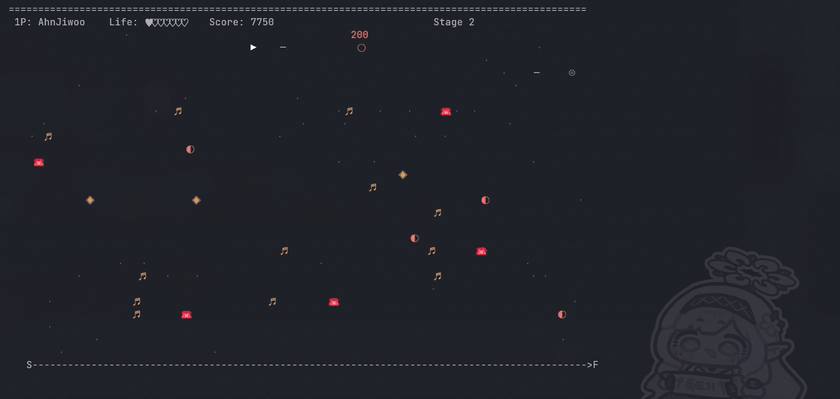

<h1 align="center">TextGradius</h1>

<p align="center">C++20과 Win32 콘솔 API로 만든 텍스트 횡스크롤 슈팅 게임</p>

<p align="center">
  
  
  
</p>


## Contents

- [프로젝트 소개](#프로젝트-소개)
- [게임 루프와 씬 전환](#게임-루프와-씬-전환)
- [콘솔 렌더링과 출력 시간](#콘솔-렌더링과-출력-시간)
- [적과 탄환의 오브젝트 풀](#적과-탄환의-오브젝트-풀)
- [점수 저장과 랭킹](#점수-저장과-랭킹)
- [빌드 및 실행](#빌드-및-실행)

## 프로젝트 소개

고전 그라디우스에서 영감을 받아, 100×30칸의 Windows 콘솔에 문자와 색만으로 횡스크롤 슈팅을 구현했습니다. 방향키로 기체를 움직이면 탄이 자동으로 발사됩니다. 적을 쓰러뜨려 점수를 얻고, 적이나 탄환에 닿으면 체력이 줄어들어 잠시 무적이 됩니다. 각 스테이지는 940프레임 동안 진행되며, 목표인 30 FPS 기준으로 두 스테이지의 전투를 합치면 약 1분입니다.


세 기체의 이동 속도는 같고 내구도, 한 발의 피해, 발사 간격이 다릅니다. 적 체력은 14로 같아서 기체마다 처치에 필요한 명중 횟수가 달라집니다.

| 기체 | 내구도 | 한 발의 피해 | 발사 간격 | 처치에 필요한 명중 |
| --- | ---: | ---: | ---: | ---: |
| ▶ Triangle | 7 | 5 | 4프레임 | 3발 |
| ♣ Clover | 5 | 3 | 2프레임 | 5발 |
| ◆ Diamond | 6 | 7 | 6프레임 | 2발 |

1스테이지에서는 위아래로 움직이며 직선탄을 쏘는 Uros가 먼저 나오고, 세 방향으로 탄을 쏘는 Call이 합류합니다. 2스테이지에서는 두 적이 번갈아 등장하다가 기체를 추격하는 Starman이 추가됩니다. Uros와 Call은 화면 왼쪽 끝을 지나면 오른쪽에서 다시 나타납니다.

## 게임 루프와 씬 전환

타이틀에서 이름을 입력하고 기체를 고르면 스테이지 소개와 전투로 이어집니다. 전투 중에는 화면 위쪽에 체력과 점수가 표시되고, 아래쪽 진행 바가 끝에 닿으면 다음 스테이지로 넘어갑니다. 두 스테이지를 통과하거나 체력이 모두 줄면 결과 화면이 나옵니다.


각 화면은 `Scene`을 상속합니다. `Game`은 현재 씬의 `Update()`를 호출하고 콘솔에 결과를 출력한 뒤, 반환된 씬 ID에 따라 다음 화면으로 넘어갑니다. 타이틀은 입력이 들어올 때 메뉴를 갱신하고, 전투 씬은 매 프레임 방향키 상태를 읽어 기체, 적과 탄환을 움직입니다. 씬마다 갱신 방식이 달라도 출력과 전환 순서는 한 곳에서 관리합니다. [게임 루프](Source/Game.cpp) · [전투 씬](Source/GameplayScene.cpp)

## 콘솔 렌더링과 출력 시간

처음에는 매 프레임 `system("cls")`로 화면을 지운 뒤 오브젝트마다 커서를 옮겨 문자를 출력했습니다. 빈 화면에서 문자가 하나씩 채워지는 과정이 드러나 깜빡였고, 화면을 지우는 명령과 반복 출력에도 시간이 들었습니다.


현재는 100×30칸의 메모리 백버퍼에 문자와 색상 속성을 `CHAR_INFO`로 기록합니다. 배경부터 HUD까지 모두 그린 뒤 `WriteConsoleOutputW`를 한 번 호출해 완성한 프레임을 콘솔 화면에 복사합니다. 화면을 비우는 중간 상태가 보이지 않고, 문자마다 커서 위치나 색을 바꾸는 호출도 줄어듭니다. [콘솔 구현](Source/Console.cpp)

별도의 벤치마크에서 100×30칸에 오브젝트 150개와 HUD 한 줄을 그려 60프레임씩 출력했습니다. 조건별로 3회 반복해 프레임당 평균 시간을 비교했습니다.

| 출력 방식 | 프레임당 평균 시간 |
| --- | ---: |
| `cls` + 오브젝트마다 `printf` | 40.04 ms |
| `cls` 생략 + 오브젝트마다 `printf` | 4.96 ms |
| 문자 배열을 만든 뒤 `printf` 1회 | 0.86 ms |
| `CHAR_INFO` 백버퍼 + `WriteConsoleOutputW` 1회 | 0.0819 ms |

30 FPS의 프레임 예산은 약 33.3 ms입니다. 첫 방식은 이 예산을 출력만으로 넘겼고, 백버퍼 방식은 약 0.25%를 사용했습니다. 두 번째 방식에서는 이전 위치의 글자가 남을 수 있지만, 화면 지우기 명령을 빼면 얼마나 빨라지는지 확인할 수 있습니다. [측정 코드](Benchmark/RenderBenchmark.cpp) · [원본 결과](Benchmark/benchmark_result.csv)


## 적과 탄환의 오브젝트 풀

전투에 들어갈 때 적과 탄환의 슬롯을 준비합니다. 적은 종류별 풀에서 비활성 슬롯을 찾아 위치와 체력을 초기화하며, 자리가 없으면 이번 등장을 건너뜁니다. 탄환은 커서가 풀을 순환하며 다음 슬롯에 덮어쓰므로 발사할 때 빈자리를 탐색할 필요가 없습니다.

| 오브젝트 | 슬롯 수 |
| --- | ---: |
| Uros, Call | 각 15 |
| Starman | 10 |
| 적 탄환 | 60 |
| 플레이어 탄환 | 20 |

적은 종류별로 보관하고 공통 `Enemy` 포인터 목록에도 등록합니다. 전투 씬은 이 목록으로 적의 갱신과 발사, 접촉 판정, 점수 수집과 그리기를 처리합니다. 이동과 공격 패턴은 각 적 클래스에서 구현합니다. [전투 씬 구현](Source/GameplayScene.cpp)

## 점수 저장과 랭킹

결과 화면에서 Enter를 누르면 플레이 ID, 이름, 점수를 공백으로 구분해 `gamedata.sav`에 한 줄씩 추가합니다. 타이틀에서 `RANKING`을 열면 파일을 읽어 점수 내림차순으로 정렬하고 상위 10건을 표시합니다. 저장 파일에는 플레이 기록이 추가된 순서대로 남습니다. [예시 기록](gamedata.sav) · [랭킹 데이터 구현](Source/RankingData.cpp)



## 빌드 및 실행

Windows에서 Visual Studio 2026의 “C++를 사용한 데스크톱 개발” 워크로드와 Windows SDK가 필요합니다. 프로젝트는 C++20과 플랫폼 도구 집합 `v145`를 사용합니다.

1. 저장소를 받습니다.

   ```powershell
   git clone https://github.com/JuggernautSensei/TextGradius.git
   ```

2. [TextGradius.slnx](TextGradius.slnx)를 열고 `TextGradius`를 시작 프로젝트로 지정합니다.
3. `Release | x64`로 빌드하고 Ctrl+F5로 실행합니다.

창 크기는 실행할 때 100열×30행으로 설정합니다. Windows Terminal에서 설정이 적용되지 않으면 창을 100열×30행 이상으로 조절합니다.

| 조작 | 키 |
| --- | --- |
| 메뉴와 기체 선택 | ↑, ↓ |
| 전투 중 기체 이동 | 방향키 (사격은 자동) |
| 결정, 스테이지 소개 건너뛰기, 결과 저장 | Enter |
| 이름 입력 중 글자 지우기 | Backspace |
