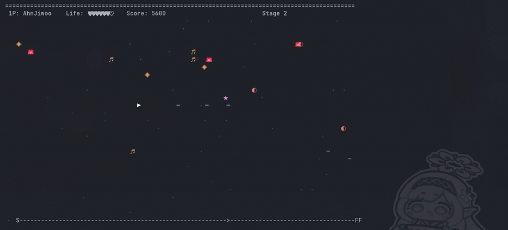

<div align="center">

# TextGradius

**콘솔 텍스트 출력으로 동작하는 횡스크롤 슈팅 게임**


<p align="center"></p>

</div>

## Contents

- [프로젝트 소개](#프로젝트-소개)
- [플레이 흐름](#플레이-흐름)
- [씬 전환과 게임 루프](#씬-전환과-게임-루프)
- [콘솔 렌더링](#콘솔-렌더링)
- [빌드 및 실행](#빌드-및-실행)

<br>

## 프로젝트 소개

그라디우스의 횡스크롤 전투에서 착안해 C++20과 Win32 콘솔 API로 만들었습니다. 100×30칸의 화면에서 별은 왼쪽으로 흐르고, 오른쪽에서 적과 탄환이 들어옵니다. 기체와 탄환, 체력과 점수는 문자와 색으로 표시합니다.

방향키로 기체를 움직여 공격을 피하고, 자동으로 발사되는 탄으로 적을 격추합니다. 두 스테이지에서 살아남으면 클리어입니다.

## 플레이 흐름

### 기체 선택

타이틀에서 `GAME START`를 고르면 이름을 입력하고 기체를 고릅니다. 세 기체의 이동 속도는 같으며, 내구도와 한 발의 위력, 발사 간격이 다릅니다.

<p align="center"></p>

| 기체 | 내구도 | 파괴력 | 발사 간격 |
|---|---:|---:|---:|
| `▶` Triangle | 7 | 5 | 4틱 |
| `♣` Clover | 5 | 3 | 2틱 |
| `◆` Diamond | 6 | 7 | 6틱 |

체력이 14인 적을 격추하려면 Clover로 다섯 발, Diamond로 두 발을 맞혀야 합니다. 탄이 자동으로 나가므로 기체를 옮겨 사격 위치를 잡습니다.

### 두 스테이지

첫 스테이지에서는 위아래로 움직이며 직선탄을 쏘는 Uros(`◐`)가 먼저 등장합니다. 진행하다 보면 세 방향으로 탄을 퍼뜨리는 Call(`☎`)이 합류합니다. 두 번째 스테이지에서는 두 적이 초반부터 번갈아 나오고, 플레이어 쪽으로 방향을 바꾸는 Starman(`★`)도 추가됩니다.

적이나 적 탄환에 닿으면 체력을 1 잃고 잠시 무적이 됩니다. 각 스테이지에서 940틱을 버티면 통과합니다. 두 번째 스테이지를 시작할 때 체력은 가득 차고, 첫 스테이지에서 얻은 점수는 이어집니다.

### 결과와 랭킹

두 스테이지를 통과하거나 체력이 다하면 결과 화면에서 최종 점수를 확인합니다. 여기서 Enter를 누르면 이름과 점수가 현재 작업 폴더의 `gamedata.sav`에 추가됩니다. 타이틀의 `RANKING`에서는 기록을 점수순으로 정렬해 최대 10개를 보여줍니다.

<p align="center"></p>

<br>

## 씬 전환과 게임 루프

타이틀, 이름 입력, 기체 선택, 스테이지 소개, 전투, 결과, 랭킹을 각각 하나의 씬으로 구성했습니다. 씬은 `Update()`에서 다음 화면의 ID를 반환하고, `Game`이 해당 씬을 생성해 `OnEnter()`를 호출합니다. 이름과 점수, 선택한 기체는 `Game`이 관리하므로 씬이 바뀌어도 이어집니다.

루프는 30FPS를 목표로 33ms를 대기한 뒤 현재 씬을 갱신하고 `Present()`로 화면을 출력합니다. 실제 틱 간격에는 갱신과 출력에 걸린 시간도 더해집니다.

전투에서는 적을 등장시키고, 플레이어와 적, 탄환을 움직인 뒤 접촉 피해를 판정합니다. 격추된 적은 소멸 연출을 마치면 점수를 한 번 넘깁니다. 그 점수를 합산한 다음 HUD를 그립니다.

```cpp
SpawnWave();
UpdateActors();
ResolveContactDamage();
CollectScores();
Render();
```

### 적과 탄환의 재사용

전투에 들어갈 때 적과 탄환을 종류별로 미리 만들어 둡니다. 적은 비활성 슬롯을 찾아 다시 등장시키고, 빈 슬롯이 없으면 그 틱의 등장을 건너뜁니다. 탄환은 발사할 때마다 배열의 다음 슬롯을 사용하고, 배열 끝에 도달하면 처음부터 순환합니다. 그 슬롯에 아직 활성 탄환이 있으면 새 탄환이 그 자리를 씁니다.

<br>

## 콘솔 렌더링

### 한 프레임을 한 번에 출력

`cls`로 화면을 지운 뒤 커서를 옮겨 문자를 하나씩 쓰면, 콘솔을 비우고 다시 채우는 과정이 화면에 보입니다. 이를 줄이기 위해 먼저 메모리의 `CHAR_INFO` 배열에 문자와 색상 속성을 채웠습니다. `Console::Present()`는 완성된 3,000칸을 `WriteConsoleOutputW` 한 번으로 콘솔 화면 버퍼에 복사합니다.

비교 영상의 왼쪽은 `GRAD_FLICKER_RENDER=1`로 빌드한 화면입니다. 같은 메모리 배열을 사용하면서도 `cls`로 콘솔을 지운 뒤 `WriteConsoleW`로 글자를 하나씩 씁니다. 오른쪽은 완성된 화면을 한 번에 복사하는 기본 빌드입니다.

<p align="center"></p>

문자열은 그리기 전에 UTF-8에서 UTF-16으로 변환합니다. `피격!`의 한글처럼 두 칸을 차지하는 글자는 연속된 두 셀에 선행·후행 속성을 붙여 놓습니다. 글자색과 배경색도 각 셀에 함께 저장합니다.

### 출력 방식 비교

`RenderBenchmark`에서 100×30칸에 오브젝트 150개와 HUD 한 줄을 그리는 네 가지 방법을 비교했습니다. 각 방법으로 60프레임을 출력하는 과정을 3회 반복해 프레임당 평균 시간을 구했습니다. 모든 방법에서 한 가지 색과 한 칸짜리 문자만 사용했습니다.

<p align="center"></p>

`cls` 후 오브젝트마다 커서를 옮기고 `printf`를 호출했을 때는 프레임당 **40.04 ms**였습니다. 화면 지우기를 생략하자 **4.96 ms**로 줄었고, 화면에 이전 프레임의 문자가 남았습니다. 화면을 문자 배열에 모아 `printf` 한 번으로 출력한 방식은 **0.86 ms**, 문자와 색상이 담긴 셀 배열을 `WriteConsoleOutputW`로 복사한 방식은 **0.08 ms**였습니다.

측정 범위는 각 방식에서 프레임을 구성하고 콘솔에 출력하는 구간입니다. 저장된 CSV에는 방식 이름과 프레임당 시간이 들어 있습니다. 재현할 때는 하드웨어와 콘솔 호스트에 따라 시간이 달라질 수 있습니다.

<br>

## 빌드 및 실행

Windows에서 C++20으로 빌드합니다. Visual Studio 2026의 **C++를 사용한 데스크톱 개발** 워크로드, MSVC `v145` 도구 집합, Windows SDK가 필요합니다.

1. 저장소를 받습니다.

   ```powershell
   git clone https://github.com/JuggernautSensei/TextGradius.git
   cd TextGradius
   ```

2. `TextGradius.slnx`를 열고 `TextGradius`를 시작 프로젝트로 지정합니다.
3. `Release | x64`를 선택하고 `Ctrl+F5`로 빌드해 실행합니다.

화면이 잘리면 콘솔 창을 넓히거나 글꼴 크기를 줄여 100열×30행이 보이도록 맞춥니다.

| 동작 | 키 |
|---|---|
| 메뉴와 기체 선택 | ↑ / ↓ |
| 전투 중 기체 이동 | 방향키 |
| 사격 | 자동 발사 |
| 선택 확정, 결과 기록, 랭킹에서 돌아가기 | Enter |
| 이름 입력 중 지우기 | Backspace |
| 스테이지 소개 건너뛰기 | Enter |
| 전투 스테이지 건너뛰기 | Enter (`Debug` 빌드) |

출력 비교를 다시 측정하려면 `RenderBenchmark`도 `Release | x64`로 빌드한 뒤, 저장소 루트에서 실행합니다. 두 번째 명령은 Python 3으로 새 CSV를 읽어 차트를 만듭니다.

```powershell
.\x64\Release\RenderBenchmark.exe benchmark_result.csv
python Benchmark/plot_benchmark.py benchmark_result.csv RenderBenchmark.svg
```
