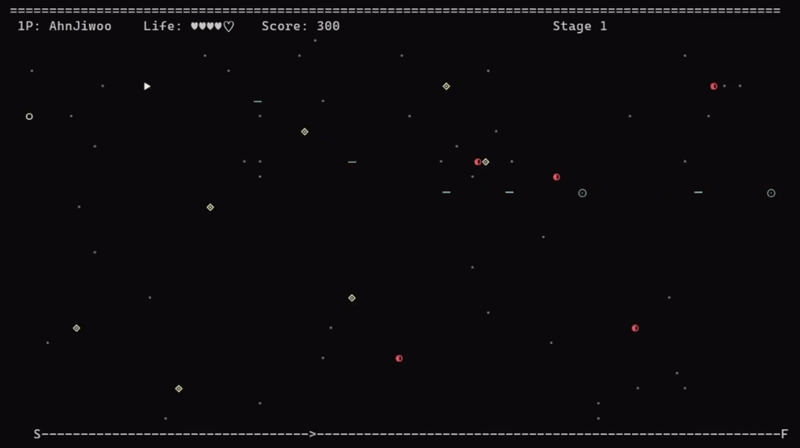
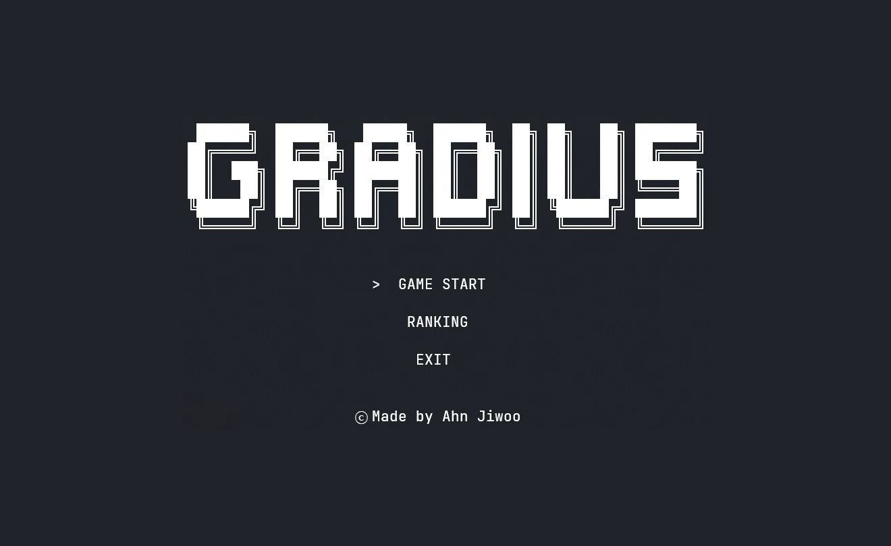
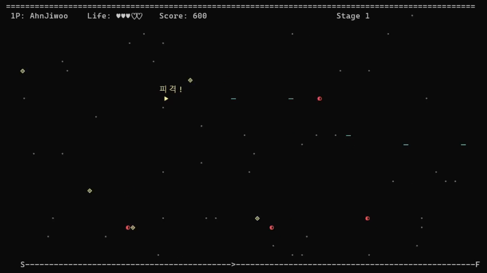
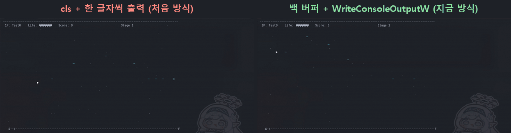

<h1 align="center">TextGradius</h1>

<p align="center">C++20과 Win32 콘솔 API로 만든 텍스트 횡스크롤 슈팅 게임</p>

<p align="center">
  
  
  
</p>


## Contents

* [프로젝트 소개](#프로젝트-소개)
* [게임 루프](#게임-루프)
* [콘솔 렌더링](#콘솔-렌더링)
* [오브젝트 풀](#오브젝트-풀)
* [랭킹 시스템](#랭킹-시스템)
* [빌드 및 실행](#빌드-및-실행)

## 프로젝트 소개

고전 게임 그라디우스에서 영감을 받아 Windows 콘솔 위에 구현한 횡스크롤 슈팅 게임입니다. 그래픽 라이브러리 없이 100×30칸의 콘솔 화면에 문자를 출력해 게임을 그립니다. 기체는 `▶`, `♣`, `◆`, 적은 `◐`, `☎`, `★`, 탄환은 `─`, `◈`, `♬` 같은 문자로 나타내고, 색은 콘솔의 글자색과 배경색 속성으로 구분합니다. 화면은 초당 30번 갱신됩니다.

플레이어는 방향키로 기체를 움직여 적의 공격을 피합니다. 사격 키는 없고 탄이 자동으로 발사되므로, 기체를 어디에 두느냐가 곧 사격입니다. 적이나 적의 탄환에 닿으면 체력이 줄고, 잠시 무적이 되어 기체가 노란색으로 바뀌며 머리 위에 `피격!`이 표시됩니다. 체력이 모두 사라지면 게임이 끝납니다. 스테이지는 두 개이고 한 판은 1분 남짓입니다.


기체는 Triangle, Clover, Diamond 세 가지입니다. 이동 속도는 같고 내구도, 파괴력, 연사력이 다릅니다. 모든 적의 체력이 같기 때문에, 이 차이는 적을 몇 발로 쓰러뜨리느냐와 얼마나 자주 쏘느냐로 나타납니다.

<table width="100%">
  <thead>
    <tr>
      <th align="left">기체</th>
      <th align="right">내구도</th>
      <th align="right">파괴력</th>
      <th align="right">연사력</th>
      <th align="left">특징</th>
    </tr>
  </thead>
  <tbody>
    <tr>
      <td>▶ Triangle</td>
      <td align="right">7</td>
      <td align="right">5</td>
      <td align="right">3</td>
      <td>내구도가 가장 높고 나머지는 두 기체의 중간입니다. 세 발이면 적을 쓰러뜨립니다.</td>
    </tr>
    <tr>
      <td>♣ Clover</td>
      <td align="right">5</td>
      <td align="right">3</td>
      <td align="right">6</td>
      <td>한 발은 약하지만 가장 빠르게 쏩니다. 내구도가 가장 낮고, 다섯 발이 필요합니다.</td>
    </tr>
    <tr>
      <td>◆ Diamond</td>
      <td align="right">6</td>
      <td align="right">7</td>
      <td align="right">2</td>
      <td>한 발이 가장 강해서 두 발이면 쓰러뜨리지만, 연사가 느립니다.</td>
    </tr>
  </tbody>
</table>

표의 수치는 기체 선택 화면에 막대로 표시되는 칸 수입니다.



적은 오른쪽에서 나타나 왼쪽으로 이동하며, 세 종류가 있습니다. 쓰러뜨리면 점수를 얻습니다.

* Uros(`◐`, 100점): 위아래로 흔들리며 다가오고, 일정한 간격으로 곧게 날아가는 탄을 쏩니다.
* Call(`☎`, 150점): Uros보다 빠르게 곧장 다가오고, 세 방향으로 퍼지는 탄을 쏩니다.
* Starman(`★`, 200점): 두 번째 스테이지에만 나옵니다. 탄은 쏘지 않고, 플레이어 쪽으로 방향을 바꿔 가며 부딪혀 옵니다. 등장하고 1초 남짓 지나면 스스로 사라지므로 그 전에 쓰러뜨려야 점수를 얻습니다. 부딪히면 피해를 입고, 점수는 10점만 남습니다.

스테이지 1은 Uros가 먼저 나오고, 시간이 지나면 Call이 합류합니다. 스테이지 2는 처음부터 Uros와 Call이 번갈아 나오고, 시간이 지나면 Starman까지 등장합니다. Uros와 Call은 화면 왼쪽 끝을 지나가도 사라지지 않고 오른쪽에서 다시 나타나므로, 쓰러뜨리지 못한 적이 화면에 계속 쌓입니다.


결과 화면에서 Enter를 누르면 이름과 점수가 기록되고, 타이틀의 `RANKING`에서 점수가 높은 순서로 상위 10개를 볼 수 있습니다.

## 게임 루프



한 판은 타이틀에서 시작해 이름 입력과 기체 선택을 거쳐 스테이지 소개와 전투로 이어집니다. 두 번째 스테이지까지 버티거나 체력이 모두 사라지면 결과 화면이 나오고, 여기서 Enter를 누르면 기록이 저장되고 타이틀로 돌아갑니다. 랭킹 화면은 타이틀 메뉴에서 따로 엽니다.



전투 화면 위쪽에는 이름, 체력(`♥`와 `♡`), 점수, 현재 스테이지가 표시됩니다. 아래쪽의 진행 바는 `S`에서 `F`까지 이어지고, `>` 표시가 스테이지의 진행도에 맞춰 오른쪽으로 움직입니다. 진행 바가 끝에 닿으면 스테이지를 통과합니다. 위 화면은 피격으로 무적 상태가 된 순간입니다.

각 화면은 `Scene`을 상속한 클래스입니다. `Game`은 `Scene` 포인터 하나만 가지고 매 프레임 `Update()`를 호출하므로, 지금 실행 중인 씬이 무엇인지, 그 안에서 무엇을 하는지 알 필요가 없습니다. 씬은 `Update()`에서 다음에 보여 줄 화면의 ID를 반환하고, `Game`은 그 프레임의 출력이 끝난 뒤에 씬을 교체합니다.

```cpp
while (true)
{
    Sleep(kFrameDelayMs);                       // 33ms

    const eSceneId next = m_scene->Update();    // 현재 씬 갱신과 백버퍼 그리기
    m_console.Present();                        // 콘솔로 한 번에 출력

    if (next == eSceneId::Exit)
    {
        break;
    }
    if (next != eSceneId::None)
    {
        m_scene = CreateScene(next);
        m_scene->OnEnter();
    }
}
```

그래서 씬마다 구현이 다릅니다. 타이틀 씬은 키 입력이 있을 때만 화면을 갱신하고, 전투 씬은 매 프레임 적과 탄환을 갱신하면서 방향키의 눌림 상태를 직접 읽습니다. 구현이 달라도 `Game`의 루프는 같고, 새 화면을 추가해도 루프는 고치지 않습니다.

## 콘솔 렌더링



처음에는 매 프레임 `system("cls")`로 화면을 지운 뒤, 오브젝트마다 커서를 옮기고 `printf`로 문자를 썼습니다. 이 방식에서는 프레임이 크게 떨어져 게임을 진행하기 어려웠고, 화면도 심하게 깜빡였습니다.

느린 이유는 출력 경로와 호출 횟수에 있었습니다. `printf`는 콘솔에 바로 쓰지 않고, 포맷 문자열을 해석하고, stdout 스트림에 잠금을 걸고, 버퍼와 인코딩을 처리한 뒤에야 Windows 콘솔 API를 호출합니다. 처음 방식은 문자 하나를 쓸 때마다 이 경로를 지났으므로, 오브젝트가 많아질수록 같은 비용이 그대로 늘어났습니다. `system("cls")`도 호출할 때마다 명령 해석기 프로세스를 새로 실행합니다. 깜빡임은 화면이 비워진 순간부터 오브젝트가 하나씩 채워질 때까지가 그대로 보였기 때문입니다.

그래서 한 프레임을 메모리에서 먼저 완성하고, 마지막에 콘솔로 한 번만 보내도록 바꿨습니다. 문자와 색상 속성을 담은 `CHAR_INFO` 배열을 백버퍼로 두고, 오브젝트는 이 배열의 셀만 바꿉니다. 그리기가 모두 끝나면 `WriteConsoleOutputW`로 배열 전체를 콘솔에 복사합니다. 색도 셀의 속성으로 함께 저장되므로 글자마다 색을 바꾸는 호출이 필요 없습니다.

```cpp
// 그리기: 콘솔에 쓰지 않고 백버퍼의 셀만 바꿉니다.
CHAR_INFO& cell       = m_cells[static_cast<size_t>(_y) * m_cols + _x];
cell.Char.UnicodeChar = _ch;
cell.Attributes       = _attr;

// 출력: 프레임마다 한 번, 100×30 영역 전체를 복사합니다.
WriteConsoleOutputW(m_hOutput, m_cells.data(), bufferSize, bufferCoord, &writeRegion);
```

콘솔에서는 화면을 지우는 단계가 없어졌으므로, 비워진 화면이 보일 틈 없이 이전 프레임 위에 완성된 다음 프레임이 덮어써집니다. 다만 그래픽스의 더블 버퍼링처럼 두 화면 버퍼를 교체하는 구조는 아닙니다. 콘솔 화면 버퍼는 하나이고, 메모리의 백버퍼를 그 위에 복사합니다. 위 비교 화면의 왼쪽은 같은 코드를 매크로 하나로 이전 방식으로 바꿔 빌드한 것입니다.

### 성능측정


원인으로 본 요소를 하나씩 바꿔 가며 프레임당 출력 시간을 쟀습니다. 100×30칸에 오브젝트 150개와 HUD 한 줄을 그리는 프레임을 60번 출력하고, 이를 3회 반복해 평균을 냈습니다.

<table width="100%">
  <thead>
    <tr>
      <th align="left">출력 방식</th>
      <th align="left">바꾼 조건</th>
      <th align="right">프레임당 시간</th>
      <th align="right">직전 대비</th>
    </tr>
  </thead>
  <tbody>
    <tr>
      <td>cls + 오브젝트마다 printf</td>
      <td>—</td>
      <td align="right">40.04 ms</td>
      <td align="right">—</td>
    </tr>
    <tr>
      <td>오브젝트마다 printf</td>
      <td>cls 제거</td>
      <td align="right">4.96 ms</td>
      <td align="right">약 8배</td>
    </tr>
    <tr>
      <td>문자 배열 + printf 1회</td>
      <td>출력 호출 151회 → 1회</td>
      <td align="right">0.86 ms</td>
      <td align="right">약 5.8배</td>
    </tr>
    <tr>
      <td>백버퍼 + WriteConsoleOutputW 1회</td>
      <td>CRT 대신 콘솔 API</td>
      <td align="right">0.0819 ms</td>
      <td align="right">약 10.5배</td>
    </tr>
  </tbody>
</table>

처음 방식의 40.04 ms가 마지막 방식에서 0.0819 ms가 되어, 프레임당 출력 시간이 약 490배 짧아졌습니다. 30fps의 프레임 예산 33.3 ms 중 0.3%도 쓰지 않는 시간입니다. 두 번째 방식은 이전 프레임의 문자가 남아 실제로 쓸 수는 없고, `cls` 한 가지의 비용만 따로 보려고 넣은 조건입니다.

## 오브젝트 풀

적과 탄환은 전투에 들어갈 때 종류별 최대 개수만큼 미리 만들어 두고, 살아 있는지 여부만 바꿔 다시 사용합니다. 풀의 크기가 곧 화면에 동시에 있을 수 있는 수의 상한입니다.

<table width="100%">
  <thead>
    <tr>
      <th align="left">오브젝트</th>
      <th align="right">풀 크기</th>
      <th align="left">빈 슬롯이 없을 때</th>
    </tr>
  </thead>
  <tbody>
    <tr>
      <td>Uros, Call</td>
      <td align="right">각 15</td>
      <td>새 적을 만들지 않음</td>
    </tr>
    <tr>
      <td>Starman</td>
      <td align="right">10</td>
      <td>새 적을 만들지 않음</td>
    </tr>
    <tr>
      <td>적 탄환</td>
      <td align="right">60</td>
      <td>가장 오래된 슬롯을 덮어씀</td>
    </tr>
    <tr>
      <td>플레이어 탄환</td>
      <td align="right">20</td>
      <td>가장 오래된 슬롯을 덮어씀</td>
    </tr>
  </tbody>
</table>

적과 탄환은 슬롯을 고르는 방식이 다릅니다. 적은 살아 있는 동안 덮어쓰면 안 되므로, 비어 있는 슬롯을 찾아 다시 등장시킵니다. 빈 슬롯이 없으면 새 적은 나오지 않습니다.

```cpp
template<typename T>
void SpawnInFreeSlot(Vector<T>& _pool)
{
    for (T& enemy: _pool)
    {
        if (!enemy.IsAlive())
        {
            enemy.Spawn();   // 위치와 체력을 초기화하고 다시 활성화합니다.
            return;
        }
    }
}
```

탄환은 빈 슬롯을 찾지 않고, 커서가 풀을 돌며 다음 슬롯에 새 탄환을 씁니다. 발사할 때 검색이 필요 없고, 풀이 가득 차면 가장 오래전에 쓴 탄환이 새 탄환으로 바뀝니다.

세 종류의 적은 서로 다른 타입의 풀에 들어 있지만, 공통 부모인 `Enemy`의 포인터 목록으로도 묶어 둡니다. 갱신, 발사, 충돌 판정, 그리기를 이 목록 하나로 처리하고, 적마다 다른 이동과 공격 방식은 각 클래스가 맡습니다.

## 랭킹 시스템

랭킹에 쓰는 기록 한 건은 플레이 ID, 이름, 점수입니다. 플레이 ID는 플레이한 시간으로 만들어지고, 세 값을 공백으로 구분한 한 줄의 텍스트로 저장합니다. 텍스트 형식이라서 편집기로 열어 바로 확인할 수 있습니다.

```text
1791430890 ahnjiwoo 7750
1791440188 jiwoo 3050
1791445462 AhnJiwoo 7950
```

직렬화는 결과 화면에서 Enter를 누를 때 일어납니다. 파일을 이어 쓰기 모드(`std::ios::app`)로 열어 기록 한 건을 파일 끝에 한 줄로 덧붙입니다. 기존 기록을 읽거나 다시 쓰지 않으므로, 기록이 쌓여도 저장하는 작업의 양은 같습니다.

```cpp
std::ofstream file(kSaveFile, std::ios::app);
file << _id << ' ' << _name << ' ' << _score << '\n';
```

역직렬화는 랭킹 화면에 들어갈 때 일어납니다. 파일을 처음부터 읽으며 ID, 이름, 점수를 차례로 꺼내 `RankEntry`로 복원하고, 모두 읽은 뒤 점수가 높은 순서로 정렬합니다. 정렬을 저장할 때가 아니라 읽을 때 하므로, 파일에는 기록된 순서가 그대로 남습니다.

```cpp
while (file >> entry.id >> entry.name >> entry.score)
{
    entries.push_back(entry);
}

std::sort(entries.begin(), entries.end(), [](const RankEntry& _a, const RankEntry& _b) { return _a.score > _b.score; });
```

## 빌드 및 실행

Windows에서 C++20으로 빌드합니다. Visual Studio의 "C++를 사용한 데스크톱 개발" 워크로드와 Windows SDK가 필요하고, 프로젝트의 플랫폼 도구 집합이 `v145`로 지정되어 있어서 Visual Studio 2026을 기준으로 합니다. 더 낮은 버전을 쓴다면 프로젝트 속성에서 플랫폼 도구 집합을 설치된 버전으로 바꿔야 합니다. 외부 라이브러리는 없습니다.

1. 저장소를 받습니다.

   ```powershell
   git clone https://github.com/JuggernautSensei/TextGradius.git
   ```

2. `TextGradius.slnx`를 Visual Studio로 열고, `TextGradius` 프로젝트를 시작 프로젝트로 지정합니다.
3. 구성을 `Release | x64`로 두고 빌드한 뒤 실행합니다(`Ctrl+F5`).

창 크기는 실행할 때 100×30으로 맞춰집니다. Windows Terminal에서는 이 설정이 적용되지 않을 수 있으며, 그때는 창을 직접 100열×30행 이상으로 조절해야 합니다.

<table width="100%">
  <thead>
    <tr>
      <th align="left">상황</th>
      <th align="left">키</th>
    </tr>
  </thead>
  <tbody>
    <tr>
      <td>메뉴, 기체 선택</td>
      <td>방향키 위, 아래</td>
    </tr>
    <tr>
      <td>전투 중 기체 이동</td>
      <td>방향키 (사격은 자동)</td>
    </tr>
    <tr>
      <td>결정, 다음 화면, 스테이지 소개 건너뛰기</td>
      <td>Enter</td>
    </tr>
    <tr>
      <td>이름 입력 중 지우기</td>
      <td>Backspace</td>
    </tr>
  </tbody>
</table>
